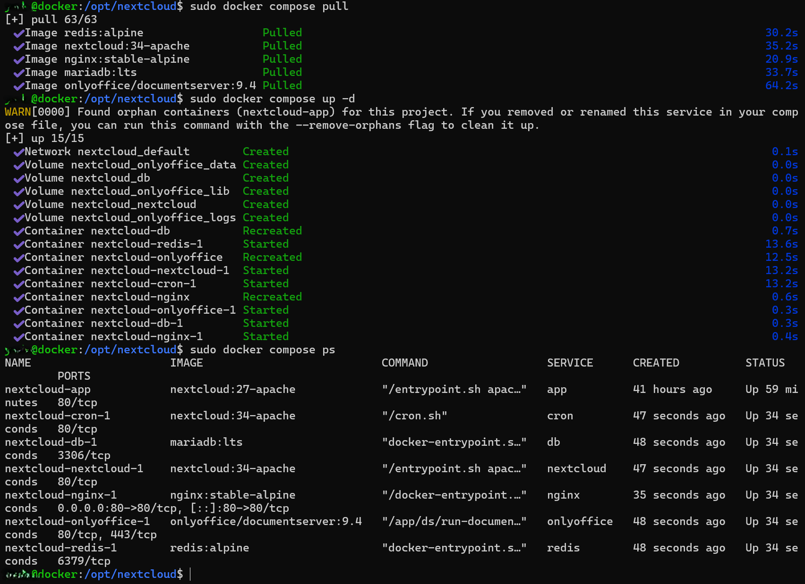
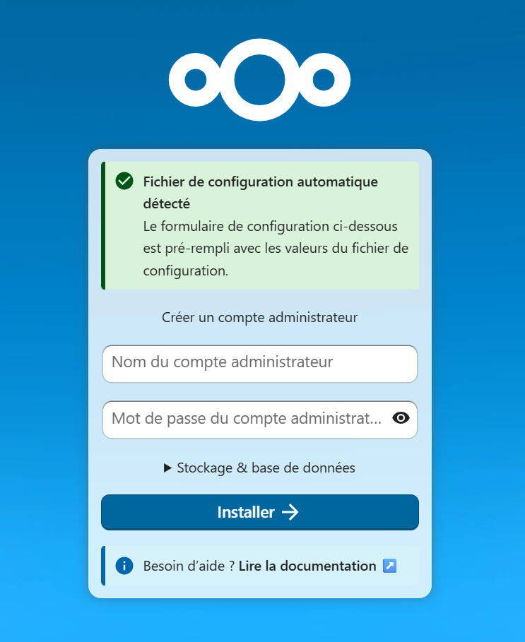

<div align="center">

# Stack Nextcloud LAN + Tailscale

### Un cloud privé auto-hébergé pour plusieurs utilisateurs, **sans aucune exposition Internet**, avec un accès distant et un certificats HTTPS autorenouvelé !


**HTTPS public · accès LAN / VPN · zéro port publié sur Internet · sauvegardes testées**

</div>

---

## 🧭 Le principe

Cette stack fait tourner **Nextcloud + ONLYOFFICE + MariaDB + Redis + Nginx** en Docker sur une VM Debian, pour un petit groupe d'utilisateurs sur un LAN.

L'astuce centrale : le nom **`cloud.example.com` est publié dans le DNS public, mais il pointe vers une adresse IP privée (RFC 1918)**. N'importe qui sur Internet peut *résoudre* le nom — personne ne peut *l'atteindre*.

- 🏠 **Depuis le LAN** : `https://cloud.example.com` fonctionne directement.
- 🔐 **À distance** : accès via **Tailscale** (subnet router + ACL), sans jamais ouvrir de port sur la box.
- 🌍 **Depuis Internet sans le VPN** : le nom résout vers une IP privée non routable → **inaccessible**.
- 📜 **Certificat HTTPS valide** délivré par **Let's Encrypt via challenge DNS-01** — le serveur n'a même pas besoin d'être joignable par Let's Encrypt. Renouvellement **automatisé** via l'API cPanel.

> 🔗 Documentation détaillée : [`docs/01-architecture.md`](docs/01-architecture.md)

## 🗺️ Architecture

```
                 INTERNET
                    │
        aucun port 80/443 publié      X
                    │
   POSTE LAN ───────┴─────── POSTE DISTANT
                              │
                              │ Tailscale (subnet router + ACL)
                              │
                              ▼
              https://cloud.example.com  →  192.168.1.20 (IP privée)
                              │
                         NGINX :443 (TLS)
                    ┌───────┴───────┐
                    ▼               ▼
                NEXTCLOUD       ONLYOFFICE (/editors/)
                    │
              ┌─────┴─────┐
              ▼           ▼
           MARIADB      REDIS
              │
      ┌───────┴────────────────────────┐
      ▼                                ▼
  disque système VM              disque de données ~2 To
  (config, DB, Docker)          /mnt/data/nextcloud/data
                                       │
              sauvegardes quotidiennes : Restic (chiffré)
                                       ▼
                          HDD backup ~2 To sur l'hyperviseur
```

| Composant | Rôle |
|---|---|
| **Nginx** | Reverse proxy TLS, point d'entrée unique `:443` |
| **Nextcloud 34** (Apache) | Stockage, partage, synchronisation multi-utilisateurs |
| **ONLYOFFICE DocumentServer 9.4** | Édition bureautique web (JWT), publié sous `/editors/` |
| **MariaDB LTS** | Base de données (dump cohérent dans les backups) |
| **Redis** | Cache + verrouillage transactionnel |
| **Cron** | Tâches de fond Nextcloud (mode `cron`, pas AJAX) |
| **Tailscale** | Accès distant : subnet routing `192.168.1.0/24` + ACL, pas de P2P inutile |
| **Restic** | Sauvegardes chiffrées, incrémentales, dédupliquées |
| **VZDump** | Snapshot de la VM sur l'hyperviseur Proxmox (disque système uniquement) |

## 🔒 Décisions de sécurité

| Choix | Pourquoi |
|---|---|
| IP privée (RFC 1918) dans le DNS public | Nom résolvable partout, serveur injoignable depuis Internet |
| Certificat Let's Encrypt via **DNS-01** | HTTPS public valide **sans exposer** de port 80/443 |
| Renouvellement TLS automatisé (API cPanel + hooks Certbot) | Pas de renouvellement manuel, timer systemd quotidien |
| ACL Tailscale durcies | Chaque poste ne joint que les services nécessaires, pas de peer-to-peer généralisé |
| SSH sur port non standard + `AllowUsers` restreint | Surface d'attaque réduite, compte `restic` dédié sans sudo |
| Montage `/mnt/data` **sans `nofail`** | Si le disque de données manque, le boot s'arrête : Nextcloud ne peut pas écrire dans un faux répertoire sur le disque système |
| `is_mountpoint=1` sur le storage de backup | L'hyperviseur ne remplit pas son SSD si le disque de backup est absent |
| Secrets dans `.env` (`chmod 600`) | Aucun secret dans le Compose ni dans Git |
| Restic chiffré + mot de passe conservé hors infra | Sauvegardes illisibles sans la clé, clé hors du SI sauvegardé |
| Tests de restauration réels (SQL + fichier) | Une sauvegarde non testée n'est pas une sauvegarde |
| Images épinglées par branche majeure | `compose pull` applique les correctifs de sécurité (ex. PHP2Shell patché en < 1 h) sans saut de version majeure |

## 📁 Contenu du dépôt

```
Stack-Nextcloud-LAN-Tailscale/
├── README.md
├── compose.yaml               # stack complète (6 services)
├── .env.example               # secrets à générer (jamais le vrai .env)
├── nginx/
│   └── default.conf           # reverse proxy TLS + ONLYOFFICE /editors/
├── certbot/
│   └── hooks/
│       ├── cpanel_dns.py      # hook DNS-01 : création/suppression TXT via API cPanel
│       └── deploy-marker.sh   # deploy hook : marqueur de renouvellement
├── scripts/
│   ├── backup-nextcloud-restic.sh       # backup quotidien (maintenance + dump SQL + Restic)
│   ├── maintenance-restic-nextcloud.sh  # rétention / prune / check hebdo
│   └── renew-nextcloud-cert.sh          # renouvellement TLS quotidien
├── systemd/
│   ├── nextcloud-restic-backup.{service,timer}       # 01:00 chaque jour
│   ├── nextcloud-restic-maintenance.{service,timer}  # dimanche 06:00
│   └── nextcloud-cert-renew.{service,timer}          # ~04:30 + délai aléatoire
└── docs/
    ├── 01-architecture.md
    ├── 02-installation.md
    ├── 03-exploitation-maintenance.md
    ├── 04-sauvegardes.md       # stratégie + procédure de restauration complète
    ├── 05-renouvellement-tls.md
    └── images/
```

## 🚀 Démarrage rapide

```bash
# 1. Préparer l'emplacement
mkdir -p /opt/nextcloud && cd /opt/nextcloud

# 2. Copier les fichiers du repo ici (compose.yaml, nginx/, .env.example...)
cp .env.example .env
openssl rand -hex 32   # ×3 : mots de passe DB, root, secret JWT
chmod 600 .env

# 3. Adapter la configuration à VOTRE environnement (voir ci-dessous)
# 4. Valider et lancer
docker compose config
docker compose pull && docker compose up -d
docker compose ps
```

⚠️ **Avant tout lancement**, remplacer les placeholders dans `compose.yaml`, `nginx/default.conf` et les scripts :

| Placeholder | Exemple dans le repo | Votre valeur |
|---|---|---|
| Domaine | `cloud.example.com` | votre sous-domaine |
| IP VM Nextcloud | `192.168.1.20` | IP de votre VM |
| IP hyperviseur / alias SSH | `192.168.1.10` / `pve-restic` | votre PVE |
| Port SSH hyperviseur | `2222` | votre port SSH |
| Disque de données | `/mnt/data` (monté par UUID, **sans nofail**) | votre disque |

L'installation complète est détaillée pas à pas dans [`docs/02-installation.md`](docs/02-installation.md).

## 💾 Sauvegardes (testées en conditions réelles)

| Quand | Quoi | Comment |
|---|---|---|
| Tous les jours 01:00 | Données + config + dump MariaDB cohérent | Restic chiffré (mode maintenance automatique) |
| Tous les jours 03:00 | VM complète (disque système) | VZDump sur l'hyperviseur |
| Dimanche 06:00 | Rétention + prune + check | Restic 7 j / 4 sem / 6 mois |

Restaurations **réellement testées** : fichier granulaire (`restic find` + `restore` + `cmp`) et dump SQL complet. Procédure de reprise complète : [`docs/04-sauvegardes.md`](docs/04-sauvegardes.md).

## 🖥️ Captures

| Démarrage de la stack | Assistant Nextcloud |
|---|---|
|  |  |


## 📚 Documentation

1. [Architecture détaillée](docs/01-architecture.md) — réseau, DNS public → IP privée, stockage, sécurité
2. [Installation pas à pas](docs/02-installation.md) — de la VM vierge au HTTPS automatique
3. [Exploitation & maintenance](docs/03-exploitation-maintenance.md) — contrôles hebdo/mensuels, stratégie de mise à jour
4. [Sauvegardes & restauration](docs/04-sauvegardes.md) — stratégie VZDump + Restic, procédure PRA complète
5. [Renouvellement TLS](docs/05-renouvellement-tls.md) — Certbot + API cPanel, hooks DNS, diagnostic

## ⚠️ Avertissement

Projet personnel documenté à but pédagogique et de partage d'expérience. J'ai mis cette architecture en production, mais **adaptez chaque valeur à votre environnement** et testez sur un environnement de test avant tout déploiement. Aucun secret réel n'est présent dans ce dépôt.

## 📜 Licence

[MIT](LICENSE) © 2026 Antonin Moisan

---

<div align="center">
<sub>Conçu pour apprendre — et pour aider à apprendre. 🤝</sub>
</div>
